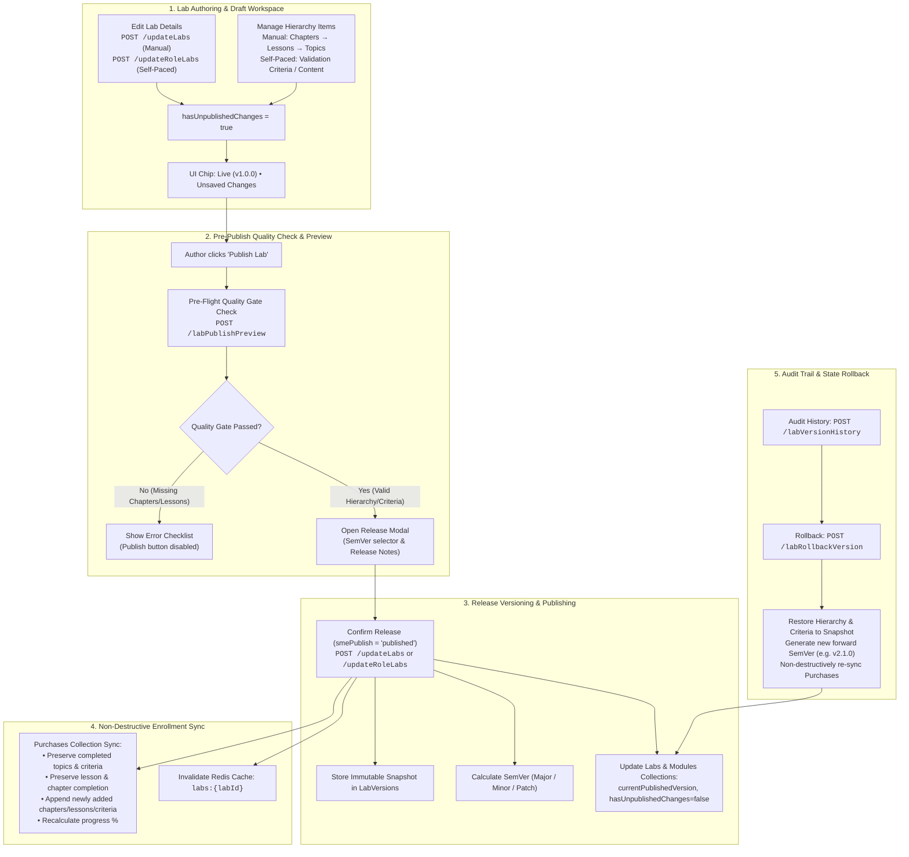

# Lab Versioning & Publishing: Frontend Integration Guide

This document is the **step-by-step frontend integration reference** for the **Lab Version Controlling and Publishing System** on **mySkillWallet**. It strictly covers **Labs** (Manually Created Labs and Self-Paced / Role Labs).

It details every API endpoint, request headers, JSON payloads, responses, Quality Gate validations, non-destructive student enrollment syncs (`Purchases.labDetails`), rollback mechanics, and UI transition states in chronological order.

---

## 1. High-Level System Architecture & Flowchart



---

## 2. Common Authentication & Request Headers

Every request requires admin, SME, or tenant authentication via a standard JWT Bearer token:

```http
Authorization: Bearer <jwt_access_token>
Content-Type: application/json
```

| Header | Type | Required | Description |
|---|---|---|---|
| `Authorization` | `string` | **Yes** | Bearer token format: `Bearer <jwt_token>`. Contains user ID (`sub`), tenant (`sortname`), and `role` (`superAdmin`, `sme`, `admin`). |
| `Content-Type` | `string` | **Yes** | Must be `application/json`. |

---

## 3. Lab Modality & Taxonomy Comparison

SkillWallet supports two distinct lab architectures. The versioning service automatically detects and adapts to both:

| Architectural Dimension | Manually Created Labs (`manual`) | Self-Paced / Role Labs (`selfPaced`) |
|---|---|---|
| **Primary Collection** | `Labs` | `Labs` (`isSelfPaced: true` or role labs) |
| **Catalog Mirror** | `Modules` (`moduleId = labId`) | `Modules` (`moduleId = labId`) |
| **Hierarchy Level 1** | `LabsChapter` (sorted by `index`) | `validationCriteria` (or chapters if present) |
| **Hierarchy Level 2** | `LabsLesson` (sorted by `index`) | Task item details / criteria |
| **Hierarchy Level 3** | `LabsTopic` (sorted by `index`) | Subtasks / verification checks |
| **Primary Edit Route** | `POST /updateLabs` | `POST /updateRoleLabs` (or `PUT /updateRoleLabs`) |
| **Quality Gate Rule** | $\ge 1$ Chapter required; **every** Chapter must contain $\ge 1$ Lesson | Title required; must provide content OR $\ge 1$ validation criterion |
| **Purchases Sync Target** | `Purchases.labDetails` (chapters &rarr; lessons &rarr; topics) | `Purchases.labDetails` (criteria/topics) |
| **Progress Calculation** | $(\text{completedTopics} / \text{totalTopics}) \times 100$ | $(\text{completedCriteria} / \text{totalCriteria}) \times 100$ |

---

## 4. Phase-by-Phase API Reference (UI Lifecycle)

---

### Phase 1: Lab Authoring & Draft Edits

When an author creates or modifies lab metadata, chapters, lessons, topics, or validation criteria:
1. Changes are immediately saved to the active draft database documents.
2. The system automatically sets:
   - `hasUnpublishedChanges: true`
   - `lastDraftUpdatedAt: <ISO Timestamp>` on both `Labs` and `Modules`.
3. **Enrolled student purchases are NOT modified during draft edits.** Students continue to interact with the currently published version without disruptions.

---

#### Step 1A: Save Manual Lab Metadata (Draft)
- **Endpoint**: `POST /updateLabs`
- **Method**: `POST`
- **Trigger**: "Save Draft" button or auto-save in Lab settings.

##### Request Payload (`application/json`)
```json
{
  "id": "672b10f84a1e9c0012345678",
  "title": "Docker & Kubernetes Containerization Lab",
  "description": "Hands-on containerization exercises.",
  "duration": "02:00:00",
  "category": "Cloud Computing",
  "complexity": "intermediate",
  "skills": ["Docker", "Kubernetes", "Linux"],
  "price": "49",
  "currency": "USD",
  "smePublish": "draft"
}
```

##### Success Response (`200 OK`)
```json
{
  "statusCode": 200,
  "message": "Lab updated successfully",
  "hasUnpublishedChanges": true
}
```
> [!TIP]
> When authors update validation criteria, learning objectives, or target skills without explicit publish intent, the changes are saved to the draft workspace with `hasUnpublishedChanges: true`. This immediately enables the **"Review & Publish"** button in the frontend.

---

#### Step 1B: Save Self-Paced / Role Lab (Draft)
- **Endpoint**: `POST /updateRoleLabs` (or `PUT /updateRoleLabs`)
- **Method**: `POST` or `PUT`
- **Trigger**: "Save Draft" button in Role Lab builder.

##### Request Payload (`application/json`)
```json
{
  "labId": "672b22a14a1e9c0087654321",
  "title": "Cloud Security Specialist Role Lab",
  "description": "Complete IAM security hardening tasks.",
  "duration": 120,
  "difficulty": "medium",
  "skills": ["AWS IAM", "CloudTrail", "GuardDuty"],
  "smePublish": "draft",
  "validationCriteria": [
    {
      "title": "Task 1: Enforce MFA",
      "criteria": "Enable MFA on root and IAM users."
    },
    {
      "title": "Task 2: Configure CloudTrail",
      "criteria": "Enable multi-region trail."
    }
  ],
  "learningObjectives": ["IAM Policies", "CloudTrail Auditing"],
  "content": "Perform the following security configurations in AWS console."
}
```

##### Success Response (`200 OK`)
```json
{
  "statusCode": 200,
  "message": "Lab updated successfully",
  "hasUnpublishedChanges": true
}
```
> [!TIP]
> When authors update validation criteria, learning objectives, or target skills without explicit publish intent, the changes are saved to the draft workspace with `hasUnpublishedChanges: true`. This immediately enables the **"Review & Publish"** button in the frontend.

---

#### Step 2: Manage Hierarchy (Chapters, Lessons, Topics)
- **Chapter Endpoints**: `POST /createLabsChapter`, `POST /updateLabsChapter`, `POST /deleteLabsChapter`, `POST /updateLabsChapterOrder`
- **Lesson Endpoints**: `POST /createLabLesson`, `POST /updateLabsLesson`, `POST /deleteLabsLesson`, `POST /updateLabsLessonOrder`
- **Topic Endpoints**: `POST /createLabsTopic`, `POST /updateLabsTopic`, `POST /deleteLabsTopic`, `POST /updateLabsTopicOrder`
- **Client State**:
  - Once any item is added, updated, or removed, `Labs` and `Modules` have `hasUnpublishedChanges: true`.
  - The UI header displays a persistent amber badge: `Published (v1.0.0) • Unsaved Changes`.

---

### Phase 2: Pre-Publish Preview & Automated Quality Gates

Before publishing, the frontend invokes `/labPublishPreview` (or `/labsPublishPreview`) to perform automated validation and inspect structural differences.

- **Endpoints**: `POST /labPublishPreview` or `POST /labsPublishPreview`
- **Method**: `POST`
- **Trigger**: Author clicks "Publish" or "Review & Publish" button in UI.

#### Request Payload (`application/json`)
```json
{
  "labId": "672b10f84a1e9c0012345678",
  "labType": "manual"
}
```
> [!NOTE]
> `labType` is optional (`"manual"` or `"selfPaced"`). If omitted, the backend auto-detects the lab kind.

---

#### Scenario 2A: Pre-Publish Check Passed (Manual Lab)
##### Response (`200 OK`)
```json
{
  "statusCode": 200,
  "labId": "672b10f84a1e9c0012345678",
  "labType": "manual",
  "canPublish": true,
  "validationErrors": [],
  "stats": {
    "totalChapters": 2,
    "totalLessons": 4,
    "totalTopics": 8,
    "totalCriteria": 0,
    "emptyChapters": [],
    "emptyLessons": []
  },
  "latestPublishedVersion": "1.0.0",
  "suggestedVersion": "1.1.0",
  "suggestedVersionType": "minor",
  "diffSummary": {
    "hasStructuralChanges": true,
    "addedChapters": ["Chapter 2: Kubernetes Pods"],
    "removedChapters": [],
    "addedLessons": ["Lesson 2: Pod Specifications"],
    "removedLessons": [],
    "addedTopics": ["Topic 2: ConfigMaps and Secrets"],
    "removedTopics": [],
    "addedCriteria": [],
    "removedCriteria": []
  }
}
```

---

#### Scenario 2B: Pre-Publish Check Passed (Self-Paced / Role Lab)
##### Response (`200 OK`)
```json
{
  "statusCode": 200,
  "labId": "672b22a14a1e9c0087654321",
  "labType": "selfPaced",
  "canPublish": true,
  "validationErrors": [],
  "stats": {
    "totalChapters": 0,
    "totalLessons": 0,
    "totalTopics": 0,
    "totalCriteria": 3,
    "totalObjectives": 3,
    "totalSkills": 3,
    "emptyChapters": [],
    "emptyLessons": []
  },
  "latestPublishedVersion": "1.0.0",
  "suggestedVersion": "1.1.0",
  "suggestedVersionType": "minor",
  "diffSummary": {
    "hasStructuralChanges": true,
    "addedChapters": [],
    "removedChapters": [],
    "addedLessons": [],
    "removedLessons": [],
    "addedTopics": [],
    "removedTopics": [],
    "addedCriteria": ["Task 3: Setup GuardDuty"],
    "removedCriteria": [],
    "modifiedCriteria": [],
    "addedObjectives": ["Threat Detection & Incident Response"],
    "removedObjectives": [],
    "addedSkills": ["AWS GuardDuty"],
    "removedSkills": [],
    "contentUpdated": false,
    "summary": "Added 1 criteria, Added 1 learning objectives, Added 1 skills: ['AWS GuardDuty']"
  }
}
```

---

#### Scenario 2C: Pre-Publish Check Failed (Quality Gate Violation)
##### Response (`200 OK` with validation errors)
```json
{
  "statusCode": 200,
  "labId": "672b10f84a1e9c0012345678",
  "labType": "manual",
  "canPublish": false,
  "validationErrors": [
    "Chapter 'Chapter 2: Kubernetes Pods' has no lessons. Add at least one lesson before publishing."
  ],
  "stats": {
    "totalChapters": 2,
    "totalLessons": 1,
    "totalTopics": 2,
    "totalCriteria": 0,
    "emptyChapters": ["672b115e4a1e9c0012345679"]
  },
  "latestPublishedVersion": "1.0.0",
  "suggestedVersion": "1.1.0",
  "suggestedVersionType": "minor",
  "diffSummary": {
    "hasStructuralChanges": true,
    "addedChapters": ["Chapter 2: Kubernetes Pods"]
  }
}
```

---

### Phase 3: Version Release & Publishing

When the author reviews the preview and clicks "Confirm Release", the frontend can publish using either of two methods:

#### Method 1: Dedicated Publish Endpoint (Recommended)
- **Endpoint**: `POST /admin/dashboard/labPublishVersion` (or `POST /labsPublishVersion`)
- **Method**: `POST`

```json
{
  "labId": "672b10f84a1e9c0012345678",
  "labType": "selfPaced",
  "versionType": "minor",
  "releaseNotes": "Added Task 3 (GuardDuty) and AWS Threat Detection learning objectives."
}
```

#### Method 2: Update Endpoint with `publishRelease: true`
- **Manual Lab**: `POST /updateLabs`
- **Self-Paced / Role Lab**: `POST /updateRoleLabs` or `PUT /updateRoleLabs`

```json
{
  "id": "672b10f84a1e9c0012345678",
  "publishRelease": true,
  "versionType": "minor",
  "releaseNotes": "Added Task 3 (GuardDuty) and AWS Threat Detection learning objectives."
}
```

| Field | Type | Required | Description |
|---|---|---|---|
| `labId` / `id` | `string` | **Yes** | Lab ObjectId. (`labId` for `labPublishVersion`/`updateRoleLabs`, `id` for `updateLabs`). |
| `publishRelease` | `boolean` | **Yes** (Method 2) | Must be `true` when calling `/updateLabs` or `/updateRoleLabs` to trigger release. |
| `versionType` | `string` | No | `"major"`, `"minor"`, or `"patch"`. If omitted, SemVer is automatically calculated based on structural diff. |
| `customVersion` | `string` | No | Optional custom SemVer override (e.g. `"3.0.0"`). |
| `releaseNotes` | `string` | No | Markdown or plain-text release notes. |

##### Success Response (`200 OK`)
```json
{
  "statusCode": 200,
  "success": true,
  "message": "Lab successfully published as version 1.1.0",
  "version": "1.1.0",
  "hasUnpublishedChanges": false
}
```

#### What the Backend Executes During Publishing:
1. Validates all Quality Gates. If invalid, publishing is aborted and returns HTTP 400.
2. Captures an immutable full-fidelity snapshot in `LabVersions`.
3. Computes the new SemVer string (e.g. `1.0.0` $\rightarrow$ `1.1.0`).
4. Updates `Labs` and `Modules`:
   - `currentVersion = "1.1.0"`
   - `currentPublishedVersion = "1.1.0"`
   - `hasUnpublishedChanges = false`
   - `lastPublishedAt = <IST Timestamp>`
   - `status = "published"`
   - `smePublish = "published"`
5. Executes non-destructive synchronization across enrolled student records in `Purchases.labDetails`.
6. Purges Redis cache key `labs:{labId}`.

---

### Phase 4: Non-Destructive Enrollment Synchronization

The publishing workflow automatically synchronizes all enrolled students in `Purchases.labDetails` without losing learner progress.

#### Non-Destructive Merge Guarantees:
1. **Preserve Completed Items**: Any topic marked `isComplete: true` remains 100% completed. In self-paced labs, completed criteria remain marked complete.
2. **Preserve Lesson & Chapter Progress**: Progress percentage for completed lessons and chapters is dynamically recalculated and never reset.
3. **Append New Template Items**: Newly added chapters, lessons, topics, or validation criteria are appended with default status `isComplete: false`, `progress: 0`.
4. **Dynamic Progress Recalculation**:
   - For Manual Labs:
     $$\text{progress} = \left\lfloor \frac{\text{completedTopics}}{\text{totalTopics}} \times 100 \right\rfloor$$
   - For Self-Paced Labs:
     $$\text{progress} = \left\lfloor \frac{\text{completedCriteria}}{\text{totalCriteria}} \times 100 \right\rfloor$$
5. **Update Version Stamp**: Sets `labVersion = "1.1.0"` and `lastSyncedVersionAt = <Timestamp>` on each enrolled purchase.

---

### Phase 5: Version History Audit & State Rollback

The frontend provides an audit log of all published releases and allows privileged authors to perform a complete state rollback to any historical version.

---

#### Step 5A: Fetch Lab Version History
- **Endpoints**: `POST /labVersionHistory` or `POST /labsVersionHistory`
- **Method**: `POST`
- **Trigger**: User opens "Version History" tab or modal in lab settings.

##### Request Payload (`application/json`)
```json
{
  "labId": "672b10f84a1e9c0012345678"
}
```

##### Response (`200 OK`)
```json
{
  "statusCode": 200,
  "message": "Lab version history fetched successfully",
  "labId": "672b10f84a1e9c0012345678",
  "labType": "manual",
  "totalVersions": 2,
  "data": [
    {
      "_id": "672b35014a1e9c0011223344",
      "version": "1.1.0",
      "versionType": "minor",
      "releaseNotes": "Added Kubernetes Pods chapter with container volume mounting exercises.",
      "publishedBy": "651a9f8e4b2d1c0099887766",
      "publishedAt": "2026-11-24T11:00:00+05:30",
      "totalChapters": 2,
      "totalLessons": 4,
      "totalTopics": 8,
      "totalCriteria": 0,
      "diffSummary": {
        "hasStructuralChanges": true,
        "addedChapters": ["Chapter 2: Kubernetes Pods"],
        "removedChapters": [],
        "addedLessons": ["Lesson 2: Pod Specifications"],
        "removedLessons": [],
        "addedTopics": ["Topic 2: ConfigMaps and Secrets"],
        "removedTopics": []
      },
      "status": "active",
      "isCurrent": true,
      "canRollback": false
    },
    {
      "_id": "672b01234a1e9c0055667788",
      "version": "1.0.0",
      "versionType": "major",
      "releaseNotes": "Initial release with Docker fundamentals chapter.",
      "publishedBy": "651a9f8e4b2d1c0099887766",
      "publishedAt": "2026-11-20T10:30:00+05:30",
      "totalChapters": 1,
      "totalLessons": 2,
      "totalTopics": 4,
      "totalCriteria": 0,
      "diffSummary": {
        "hasStructuralChanges": true,
        "type": "initial_publish",
        "summary": "Initial release"
      },
      "status": "active",
      "isCurrent": false,
      "canRollback": true
    }
  ]
}
```

---

#### Step 5B: Execute Complete State Rollback
When an author needs to revert to a prior release (e.g. `v1.1.0` introduced an unstable exercise and they want to restore `v1.0.0`):
- The backend restores the active hierarchy collections (`LabsChapter`, `LabsLesson`, `LabsTopic`) or `validationCriteria` to the exact state stored in `targetVersion`'s snapshot.
- Historical versions are preserved.
- The system generates a **new forward release** (e.g. restoring `v1.0.0` produces release `v1.2.0` or `v2.1.0`).
- Student purchase details are re-synchronized non-destructively.

- **Endpoints**: `POST /labRollbackVersion` or `POST /labsRollbackVersion`
- **Method**: `POST`
- **Trigger**: Author confirms target version and reason in Rollback Modal.

##### Request Payload (`application/json`)
```json
{
  "labId": "672b10f84a1e9c0012345678",
  "targetVersion": "1.0.0",
  "reason": "Reverting unstable Kubernetes Pods exercise.",
  "versionType": "minor"
}
```

##### Success Response (`200 OK`)
```json
{
  "statusCode": 200,
  "success": true,
  "message": "Lab successfully restored to state of version 1.0.0 as new release 1.2.0",
  "labId": "672b10f84a1e9c0012345678",
  "labType": "manual",
  "newVersion": "1.2.0",
  "restoredFromVersion": "1.0.0",
  "versionId": "672b49004a1e9c0099001122",
  "versionType": "minor",
  "isRollback": true,
  "restorationStats": {
    "restoredChapters": 1,
    "restoredLessons": 2,
    "restoredTopics": 4
  },
  "enrollmentSync": {
    "totalEnrolled": 38,
    "enrollmentsUpdated": 38
  }
}
```

---

## 5. Error Handling & Validation Matrix

| HTTP Status | Error Message / Pattern | Root Cause | Frontend UI Display | User Remediation |
|---|---|---|---|---|
| `400` | `"Pre-publish quality check failed: Lab must have at least one chapter before publishing."` | Manual lab has 0 chapters created. | Red Banner: "Quality Gate Failed" | Prompt author to click "+ Add Chapter" before publishing. |
| `400` | `"Pre-publish quality check failed: Chapter '<name>' has no lessons."` | One or more chapters have 0 lessons attached. | Red Checklist: Highlights empty chapter names. | Author must add at least 1 lesson to each flagged chapter. |
| `400` | `"Self-paced lab must provide at least one validation criterion, instructions content, or chapter before publishing."` | Self-paced lab has no tasks or instructions. | Red Banner: "Quality Gate Failed" | Add at least 1 validation criterion or instructions content. |
| `400` | `"Lab is already actively at version ... with no unpublished changes"` | Attempting rollback to current active version when no draft changes exist. | Toast Error: "Already at this version" | Select a different historical version to rollback. |
| `400` | `"labId is required"` / `"labId and targetVersion are required"` | Missing query or body fields in API request. | Developer Warning / Form Alert | Ensure payload includes valid IDs. |
| `401` | `"token is missing"` / `"Token Expired"` | Auth header missing or JWT session expired. | Redirect to Login modal. | Refresh token or prompt user to re-authenticate. |
| `403` | `"Lab Title already exist"` | Another lab has an identical title in the current tenant. | Field-level error under "Lab Title". | Change the title to be unique. |
| `404` | `"Lab not found"` | Lab ID does not exist in `Labs`. | 404 View: "Lab Not Found" | Check navigation URL / ID. |
| `404` | `"Target version '<version>' not found in version history for this lab"` | Requested rollback SemVer doesn't exist in `LabVersions`. | Modal Error: "Target version not found" | Refresh version history list. |
| `301` | `"Lab not updated"` | Payload matched current DB record exactly. | Info Toast: "No changes to save" | Inform user draft is already up to date. |
| `500` | `"Internal Server Error"` | Unhandled backend exception or database timeout. | Alert: "Server error. Please retry." | Check server logs or report incident. |
